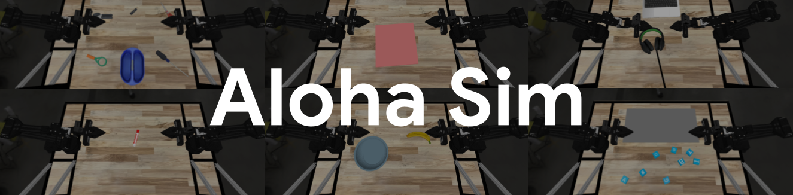
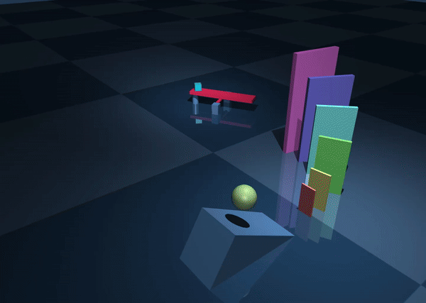
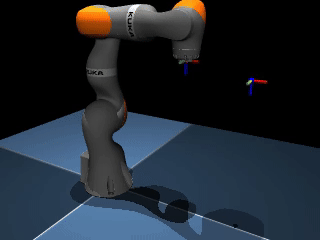
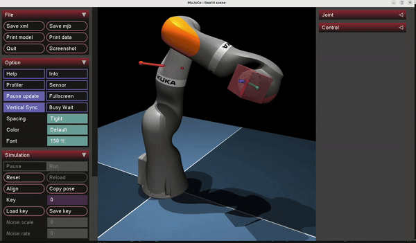
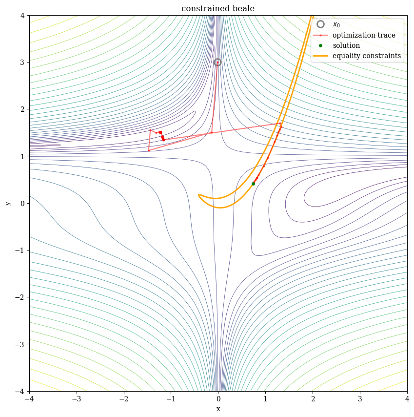
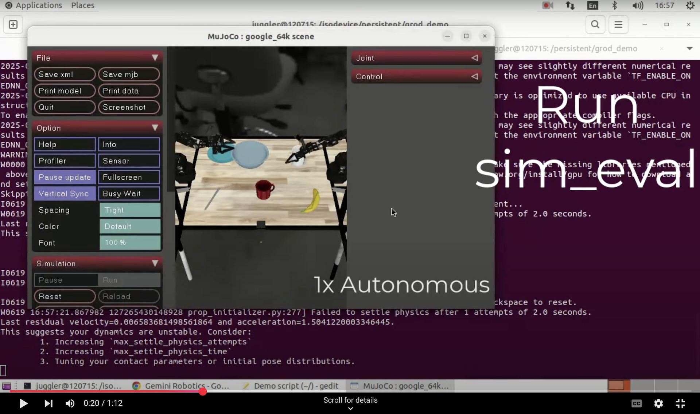
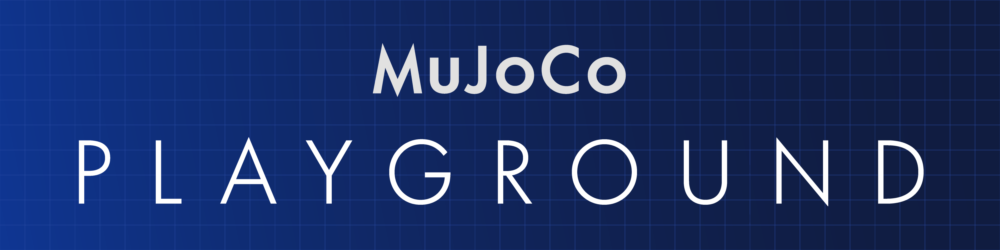

# MuJoCo Robotics Tutorials (Windows Edition)



**Windows 환경**에서 [MuJoCo](https://mujoco.org/) 물리 엔진과 **Jupyter Notebook(`.ipynb`)**을 통해 로보틱스의 기초부터 매니퓰레이터 제어, 수치 최적화, 궤적 생성/MPC, 그리고 **ALOHA 2 양팔 로봇(Bimanual Manipulation) 시뮬레이션**까지 단계별로 학습할 수 있는 통합 튜토리얼 프로젝트입니다.

모든 로봇·물체 에셋(`assets/`), 파이썬 제어기 및 태스크 패키지(`src/`), 실습 노트북(`notebooks/`), 그리고 웹 문서(`docs/`)가 하나의 일관된 구조로 통합되어 있습니다.

---

## 1. 환경 설치 방법 (빠른 시작)

이 프로젝트는 초고속 파이썬 패키지 매니저인 **[`uv`](https://docs.astral.sh/uv/)**를 사용하여, PC에 Python이 설치되어 있지 않더라도 **Python 3.11 다운로드부터 가상환경(`.venv`) 생성, 필수 패키지 및 `src/` 통합 패키지(`controllers`, `tasks`, `utils`) 설치, Jupyter 커널 등록까지 한 번에 자동 처리**합니다.

### 방법 A: 원클릭 자동 설치 (권장)
프로젝트 폴더의 **[`setup_env.bat`](./setup_env.bat)** 파일을 더블클릭하거나, PowerShell 터미널에서 아래 명령어를 실행하세요:

```powershell
.\setup_env.ps1
```

### 방법 B: `uv` 명령어 직접 실행
```powershell
uv sync
```

### 방법 C: 기존 `pip` + `venv` 사용 시
```powershell
python -m venv .venv
.\.venv\Scripts\activate
pip install -r requirements.txt
pip install -e .
```

---

## 2. 실습 노트북 및 웹 문서 실행 방법

### 1) VS Code / Cursor / Antigravity 내장 에디터에서 실행
1. **[`notebooks/`](./notebooks)** 폴더 안의 `01_mujoco_basic.ipynb` ~ `06_aloha_bimanual_sim.ipynb` 파일을 엽니다.
2. 우측 상단 **커널 선택(Select Kernel)**에서 **`.venv (Python 3.11)`** 또는 **`Python (MuJoCo Robotics)`**를 선택합니다.
3. 위에서부터 순서대로 셀(`Shift + Enter`)을 실행하며 학습합니다.

### 2) Jupyter Lab 브라우저 실행
**[`run_jupyter.bat`](./run_jupyter.bat)** 파일을 더블클릭하거나 터미널에서 아래 명령어를 실행하세요:

```powershell
uv run jupyter lab
```

### 3) 웹 문서(MkDocs Material)로 학습 과정 확인하기
**[`run_docs.bat`](./run_docs.bat)** 파일을 더블클릭하거나 아래 명령어를 실행하면, 로컬 웹 서버(`http://127.0.0.1:8000`)에서 이론 요약 가이드와 **전체 Jupyter Notebook(`.ipynb`)이 웹페이지로 렌더링된 화면**을 바로 확인할 수 있습니다:

```powershell
uv run mkdocs serve
```

> 또한 `main` 브랜치에 푸시할 때마다 [`.github/workflows/deploy-docs.yml`](./.github/workflows/deploy-docs.yml) 워크플로우를 통해 **GitHub Pages**로 자동 빌드·배포됩니다.

---

## 3. 커리큘럼 및 주요 내용 (`notebooks/`)

노트북 번호 순서(`01` → `06`)대로 학습하시는 것을 권장합니다.

| 순서 및 파일 | 웹 가이드 문서 | 주요 학습 내용 | 데모 미리보기 |
| :--- | :--- | :--- | :---: |
| **[notebooks/01_mujoco_basic.ipynb](./notebooks/01_mujoco_basic.ipynb)**<br>MuJoCo 기초 및 물리 시뮬레이션 | [01. 가이드](./docs/curriculum/01_mujoco_basic.md) | - MJCF(XML) 모델링 문법 및 기본 요소<br>- 정적 모델(`mjModel`)과 동적 상태(`mjData`) 구조<br>- 자유도(DoF), 일반화 좌표계(`qpos`, `qvel`), 쿼터니언<br>- 뒤집히는 팽이(Tippe-Top) 및 카오스 진자 시뮬레이션<br>- 타임스텝(`timestep`)과 에너지 보존, 수치 발산 분석<br>- 접촉력(Contact Force), 마찰, 힘줄, 액추에이터, 가속도계 센서<br>- 깊이/세그멘테이션 카메라, 투영 행렬, 도미노 및 동적 카메라 워킹 |  |
| **[notebooks/02_robot_arms.ipynb](./notebooks/02_robot_arms.ipynb)**<br>로봇 팔(매니퓰레이터) 기구학 및 제어 | [02. 가이드](./docs/curriculum/02_robot_arms.md) | - 6자유도 **UR5e**, 7자유도 **Franka Emika Panda**, **KUKA iiwa 14** 제어<br>- 미분 역기구학(Differential IK): 자코비안(`mj_jacSite`) 및 쿼터니언 자세 오차<br>- 영공간(Null-Space) 제어: KKT 조건을 이용한 여유 자유도 관절 자세 최적화<br>- 작업 공간 제어(Operational Space Control, OSC): 작업 공간 관성 행렬($\Lambda$)과 중력/코리올리 보상을 통한 **직접 토크 제어** |  |
| **[notebooks/03_robot_arm_mocap.ipynb](./notebooks/03_robot_arm_mocap.ipynb)**<br>인터랙티브 3D 뷰어 & 마우스 모캡 제어 | [03. 가이드](./docs/curriculum/03_robot_arm_mocap.md) | - `OperationalSpaceController` 모듈화 및 3차원 8자(Lissajous) 모캡 궤적 추종<br>- MuJoCo 내장 인터랙티브 3D 뷰어(`mujoco.viewer.launch_passive`) 실행<br>- 마우스 드래그(`Ctrl` + 클릭)로 타겟을 실시간 이동/회전시키고 로봇에 외력을 가하며 임피던스 순응성(Compliance) 체험 |  |
| **[notebooks/04_optimization.ipynb](./notebooks/04_optimization.ipynb)**<br>로보틱스를 위한 비볼록 수치 최적화 | [04. 가이드](./docs/curriculum/04_optimization.md) | - 뉴턴 방법(Newton's Method)과 **레벤버그-마쿼트(Levenberg-Marquardt)** 정규화<br>- 비선형 최소제곱법과 **가우스-뉴턴(Gauss-Newton)** 근사법 ($H \approx J^T J$)<br>- `mujoco.minimize.least_squares` 및 JAX 자동 미분 실습<br>- 등식 제약 조건부 최적화: **페널티 방법(Penalty)**, **원시-쌍대 KKT 뉴턴-랩슨(Primal-Dual)**, **증강 라그랑지안(Augmented Lagrangian)** 비교 |  |
| **[notebooks/05_direct_transcription_mpc.ipynb](./notebooks/05_direct_transcription_mpc.ipynb)**<br>직접 전사법 궤적 최적화 및 MPC | [05. 가이드](./docs/curriculum/05_direct_transcription_mpc.md) | - 언더액추에이티드 카트폴(Cart-Pole / 도립진자) 동역학 모델링<br>- `casadi.Callback`을 이용한 MuJoCo 이산 동역학 심볼릭 래핑(`enable_fd`)<br>- **직접 전사법(Direct Transcription)** NLP 정식화 및 **IPOPT** 솔버를 통한 스윙업(Swing-up) 궤적 생성<br>- **Warm-start** 기반 실시간 **모델 예측 제어(MPC)** 루프 구현 | - |
| **[notebooks/06_aloha_bimanual_sim.ipynb](./notebooks/06_aloha_bimanual_sim.ipynb)**<br>ALOHA 2 양팔 로봇 및 20종 태스크 실습 | [06. 가이드](./docs/curriculum/06_aloha_bimanual_sim.md) | - **ALOHA 2** 양팔 매니퓰레이터(ViperX 300s 6-DoF × 2 + 그리퍼 × 2) PBR 모델 구조<br>- 4개 내장 카메라(`overhead_cam`, `worms_eye_cam`, `wrist_cam_left/right`) 멀티뷰 렌더링<br>- **양팔 미분 역기구학(Bimanual Differential IK)** 동시 제어<br>- `dm_control.composer` 기반 **20종 일상 물체 조작 벤치마크(`task_suite`)** 실습 및 Windows 인터랙티브 3D 뷰어 연동 |  |
| **[notebooks/07_mujoco_playground_mjx.ipynb](./notebooks/07_mujoco_playground_mjx.ipynb)**<br>MuJoCo Playground & MJX 병렬 로봇 학습 | [07. 가이드](./docs/curriculum/07_mujoco_playground_mjx.md) | - **MuJoCo MJX (`mujoco.mjx`)**와 `jax.vmap`을 활용한 **1,024+ 병렬 환경 동시 시뮬레이션** 및 처리량 벤치마크<br>- Playground 설계 패턴(`sim_dt` vs `ctrl_dt`, `reward.tolerance`) 및 실시간 **MPPI 샘플링 제어**<br>- **Unitree Go1 사족보행(Locomotion)**: 조이스틱 속도 명령 3D 화살표 시각화, 외란(Velocity Kick) 회복, 발 스윙 피크(`swing_peak`) 진단 플롯, **Sim-to-Real 도메인 랜덤화**<br>- **LEAP Hand 다지 로봇 손 조작(Dexterous Manipulation)**: 인핸드 $SO(3)$ 큐브 회전 및 **비대칭 액터-크리틱(`state` vs `privileged_state`)** 관측 설계 |  |

---

## 4. 통합 프로젝트 구조

```text
MujocoTutorials/
├── assets/                            # 모든 로봇 및 3D 물체 모델 통합 디렉토리
│   ├── mujoco_menagerie/              # [Git Submodule] Google DeepMind 공식 50+종 로봇 메쉬 및 모델 저장소
│   ├── robots/                        # 튜토리얼 전용 MJCF 설정 (모캡 타겟, 토크 액추에이터, ALOHA 2 PBR 텍스처)
│   ├── objects/                       # YCB, GSO, EDR, Letters, MuJoCo 3D 물체 에셋
│   └── imgs/                          # 튜토리얼 데모 GIF 및 배너 이미지
├── src/                               # 통합 파이썬 소스 패키지
│   ├── controllers/                   # 제어기 모듈 (OperationalSpaceController 등)
│   ├── tasks/                         # dm_control 기반 20종 양팔 조작 태스크 (task_suite)
│   ├── utils/                         # Windows 노트북 초기화(notebook_setup), OOBB 계산 등
│   ├── viewer.py                      # 인터랙티브 3D 뷰어 실행기
│   └── run_eval.py                    # 벤치마크 평가 스크립트
├── notebooks/                         # 단계별 실습 Jupyter Notebook (.ipynb) 6종
├── docs/                              # MkDocs 웹 문서 및 커리큘럼 가이드
├── mkdocs.yml                         # MkDocs Material + mkdocs-jupyter 설정
├── pyproject.toml                     # uv 프로젝트 및 의존성 설정 파일
├── requirements.txt                   # pip 호환용 패키지 목록
├── setup_env.bat / setup_env.ps1      # Windows 원클릭 가상환경 및 패키지 자동 설치 스크립트
├── run_jupyter.bat                    # Jupyter Lab 실행 런처 스크립트
└── run_docs.bat                       # 로컬 웹 문서 서버(MkDocs) 실행 런처 스크립트
```

---

## 5. 참고 자료 (References)

| 참고 자료 | 저자 / 출처 | 설명 |
| :--- | :--- | :--- |
| [MuJoCo Official Tutorials](https://github.com/google-deepmind/mujoco) | Google DeepMind | 공식 MuJoCo Python 바인딩 및 최적화 튜토리얼 |
| [ALOHA Sim](https://github.com/google-deepmind/aloha_sim) | Google DeepMind | ALOHA 2 양팔 로봇 시뮬레이션 환경 및 벤치마크 태스크 |
| [mjctrl](https://github.com/kevinzakka/mjctrl) | Kevin Zakka | MuJoCo 기반 단일 파일 로보틱스 제어기 구현 모음 |
| [Robotic Manipulation](https://manipulation.mit.edu/) | Russ Tedrake (MIT) | 매니퓰레이션 기구학 및 제어 강의 노트 |
| [Nonlinear Least Squares Notes](https://www.seas.ucla.edu/~vandenbe/133B/lectures/nllseq.pdf) | Lieven Vandenberghe (UCLA) | 비선형 최소제곱법 및 제약 조건부 최적화 강의 노트 |
