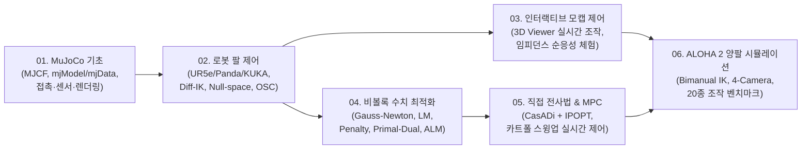

# MuJoCo Robotics Tutorials (Windows Edition)

**Windows 환경**에서 [MuJoCo](https://mujoco.org/) 물리 엔진과 **Jupyter Notebook(`.ipynb`)**을 통해 로보틱스의 기초부터 매니퓰레이터 기구학/토크 제어, 비볼록 수치 최적화, 궤적 생성/MPC, 그리고 **ALOHA 2 양팔 로봇(Bimanual Manipulation) 시뮬레이션**까지 체계적으로 학습할 수 있는 통합 튜토리얼 프로젝트입니다.

---

## 학습 로드맵 (Learning Roadmap)

---

## 단계별 커리큘럼 요약

| 단계 | 가이드 문서 | 실습 노트북 (웹 뷰어) | 핵심 주제 | 데모 미리보기 |
| :---: | :--- | :--- | :--- | :---: |
| **01** | [01. MuJoCo 기초 가이드](curriculum/01_mujoco_basic.md) | [01_mujoco_basic.ipynb](notebooks/01_mujoco_basic.ipynb) | MJCF 모델링, `mjModel`/`mjData`, 일반화 좌표계(`qpos`, `qvel`), 뒤집히는 팽이, 카오스 진자, 접촉력·마찰·센서, 깊이/세그멘테이션 카메라 및 도미노 |  |
| **02** | [02. 로봇 팔 제어 가이드](curriculum/02_robot_arms.md) | [02_robot_arms.ipynb](notebooks/02_robot_arms.ipynb) | UR5e / Franka Panda / KUKA iiwa 14 모델, 미분 역기구학(Diff-IK), 영공간(Null-Space) KKT 최적화, 작업 공간 토크 제어(OSC) |  |
| **03** | [03. 인터랙티브 모캡 가이드](curriculum/03_robot_arm_mocap.md) | [03_robot_arm_mocap.ipynb](notebooks/03_robot_arm_mocap.ipynb) | `OperationalSpaceController` 모듈화, 3D 리사주(8자) 궤적 추종, `mujoco.viewer.launch_passive` 실시간 마우스 조작 및 외력 순응성 체험 |  |
| **04** | [04. 비볼록 최적화 가이드](curriculum/04_optimization.md) | [04_optimization.ipynb](notebooks/04_optimization.ipynb) | 뉴턴법, 레벤버그-마쿼트(LM) 정규화, 가우스-뉴턴(Gauss-Newton), 페널티 방법, 원시-쌍대 KKT 뉴턴-랩슨, 증강 라그랑지안(ALM) |  |
| **05** | [05. 직접 전사법 & MPC 가이드](curriculum/05_direct_transcription_mpc.md) | [05_direct_transcription_mpc.ipynb](notebooks/05_direct_transcription_mpc.ipynb) | 카트폴(도립진자) 동역학, `CasadiMujocoWrap` 유한차분 래핑, 직접 전사법(Direct Transcription) 스윙업, Warm-start 실시간 MPC | - |
| **06** | [06. ALOHA 2 양팔 로봇 가이드](curriculum/06_aloha_bimanual_sim.md) | [06_aloha_bimanual_sim.ipynb](notebooks/06_aloha_bimanual_sim.ipynb) | ALOHA 2 양팔(14-Actuator) PBR 모델, 4-카메라 멀티뷰 렌더링, 양팔 미분 역기구학(Bimanual IK), `dm_control` 기반 20종 일상 조작 태스크 |  |

---

## 주요 특징

* **Windows 원클릭 환경 구축 (`setup_env.bat`)**: `uv` 패키지 매니저를 통해 PC에 Python이나 FFmpeg가 설치되어 있지 않아도 **Python 3.11 + 모든 필수 패키지 + 내장 FFmpeg 연결 + Jupyter 커널 등록**이 한 번에 완료됩니다.
* **단일 통합 아키텍처**: 단팔 로봇(UR5e, Panda, KUKA)과 양팔 로봇(ALOHA 2), 3D 일상 물체 에셋(YCB, GSO, EDR)이 `assets/` 아래에 통합되어 있고, 모든 파이썬 제어기·태스크·유틸리티는 `src/` 패키지(`controllers`, `tasks`, `utils`)로 일원화되어 있습니다.
* **웹 문서 & 노트북 동시 제공**: `run_docs.bat`을 실행하거나 GitHub Pages를 통해 브라우저에서 이론 요약 가이드와 실행 결과가 포함된 전체 `.ipynb` 노트북을 바로 열람할 수 있습니다.

